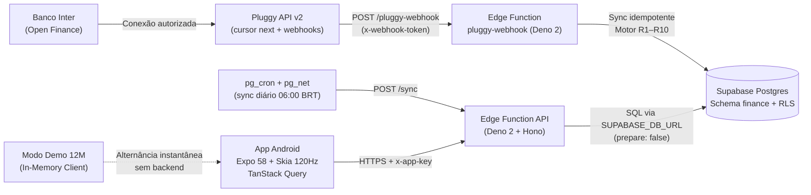

# Gerenciador de Gastos — Open Finance, Supabase RLS & Liquid Glass 120Hz

[](https://github.com/Cawlino/gerenciador-de-gastos/actions/workflows/ci.yml)


> **English TL;DR:** End-to-end Android personal finance app built with **React Native (Expo SDK 58, New Architecture)**, custom **Skia SkSL Liquid Glass shaders tuned to 120Hz**, **Supabase (PostgreSQL + isolated schema + RLS + Deno/Hono Edge Functions)**, and **Open Finance (Pluggy API v2)**. Includes a deterministic **12-Month In-Memory Demo Mode** and **Privacy Eye (`R$ ••••`)** so anyone can clone and explore the entire app without backend credentials or exposing personal data.

---

## 🔒 Privacidade & Segurança em Primeiro Lugar

Este repositório contém **100% do código-fonte, arquitetura, testes e design system**, sem **nenhum dado financeiro pessoal, extrato real, chave de API ou credencial**:
- Todas as variáveis sensíveis permanecem exclusivamente em `.env` / `mobile/.env` locais (ignorados pelo Git) e em `supabase secrets`.
- O repositório inclui **Modo Demo 12M em memória** (`mobile/src/utils/demoDataGenerator.ts`) e **Modo Privacidade (Olho)** para demonstrações seguras sem tocar no banco de produção.
- A esteira `T1` (`scripts/check-pii.mjs` + `secretlint` + `gitleaks`) roda localmente no hook `.husky/pre-commit` e no GitHub Actions para impedir vazamento de segredos, URLs de produção, e-mails pessoais ou dados de `PII_GUARD`.

---

## 🎯 O Problema Real e a Solução

Integrar uma conta corrente e um cartão de crédito via Open Finance parece direto até surgirem as armadilhas reais dos dados bancários:
- **Cartão de crédito inverte sinais:** compras chegam como `DEBIT` positivo e estornos/pagamentos como `CREDIT` negativo.
- **Contagem dupla na fatura:** pagar a fatura gera uma saída na conta corrente e uma entrada no cartão — sem pareamento inteligente, as despesas e receitas ficam infladas.
- **Virada de mês em UTC:** uma compra às `22:30` em Brasília (`01:30Z` do dia seguinte) cai no mês errado se o fuso `America/Sao_Paulo` não for calculado na origem.
- **Categorização genérica:** transferências PIX chegam sem categoria útil e exigem regras persistentes por CNPJ, CPF ou descrição normalizada sem sobrescrever edições manuais.

Para resolver isso ponta a ponta, o projeto combina um **motor financeiro determinístico (`R1–R10`)** no backend PostgreSQL/Deno com uma **interface Android nativa a 120Hz em GPU**.

---

## 🏗️ Arquitetura do Sistema



### Destaques Técnicos
- **Isolamento Zero-Trust no Banco (`supabase/migrations/`):** todas as tabelas ficam no schema dedicado `finance` com **Row Level Security (RLS) ativo e zero policies**, além de `REVOKE ALL` para `anon` e `authenticated`. O app nunca acessa o PostgREST diretamente.
- **Motor Financeiro `R1–R10` (`supabase/functions/_shared/rules.ts` e `categorize.ts`):** normalização de sinal do cartão (`R1`), pareamento automático de pagamento de fatura em janela `±5 dias` (`R2`), abatimento de estornos (`R3`), exclusões configuráveis de mesma titularidade e investimentos (`R4/R5`), conversão temporal para `America/Sao_Paulo` via trigger SQL (`R6`), cálculo de pendentes e taxonomia recursiva (`R7/R8`), regras persistentes `CNPJ > CPF > descrição` (`R9`) e limites de cartão (`R10`).
- **Interface *Liquid Glass* em GPU (`mobile/src/shaders/thickGlassShader.ts`):** shader SkSL customizado em `@shopify/react-native-skia` com SDF `sdRoundedRect`, refração de borda, dispersão cromática RGB, realce especular e auras dinâmicas sincronizadas com gestos em `120Hz`.
- **Central `/analytics` & Privacidade (`mobile/app/analytics.tsx`):** 4 KPIs executivos (*Taxa de Poupança*, *Burn Rate Diário*, *Runway* e *Sobra Acumulada*) + 7 módulos visuais renderizados em Skia GPU + botão global de privacidade (`R$ ••••`) e simulador **Demo 12M**.

---

## 🧭 A Trajetória de Engenharia (Do Zero à Produção em 120Hz)

Este projeto foi construído de forma incremental em **4 grandes marcos**, documentados em **22 ADRs** ([`.context/DECISIONS.md`](.context/DECISIONS.md)):

### Marco 1 — Fundação, Segurança & Backend Open Finance (`R1–R10`)
- Criação do schema isolado `finance`, 130 categorias oficiais PT-BR da Pluggy (`supabase/seed.sql`), views recursivas (`v_categories_resolved`, `v_transactions_effective`) e RPCs `dashboard(p_month)` e `apply_rule_to_transactions(uuid)`.
- Cliente Pluggy v2 com paginação completa por cursor `next`, upsert em lotes via `jsonb_to_recordset`, webhook protegido por `x-webhook-token` (`timingSafeEqual`) e agendamento diário via `pg_cron` + `pg_net` com resolução de namespace em runtime.
- Validação com `pgTAP` (`36` asserções SQL), testes unitários Deno (`T3`), integração local com mock Pluggy v2 (`T5`) e contrato read-only contra a API real (`T6`).

### Marco 2 — Design System *Liquid Glass* em Skia Shaders
- Evolução de `BlurView` (que sofria fallback no Android) para shaders SkSL dedicados em GPU (`thickGlassShader.ts`), desenhando vidro translúcido reativo ao fundo oceânico com auras móveis e barra inferior expansível/magnética acoplada a gestos horizontais (`react-native-gesture-handler` + `Reanimated`).

### Marco 3 — Otimização Extrema de Performance para 120Hz
- Profiling em dispositivo Android físico (120Hz) via `dumpsys gfxinfo` e `logcat` revelou `31,82%` de *jank* (`17ms` p50 UI thread) causado por capturas síncronas em CPU e múltiplas alocações de `withSpring` por quadro.
- Refatoração completa para um **único `useFrameCallback` sem alocações** (`MotionContext.tsx`), escopo de scroll por aba, *culling* de superfícies Skia fora da viewport e empacotamento quantizado de *uniforms* (`packGlassUniformKey` em 52 bits).
- **Resultado medido no aparelho:** *jank* reduzido para **`~2,0%–2,56%`**, **`0` *Missed Vsync***, UI thread p50 em **`9–10 ms`** e GPU Vulkan em **`2–3 ms`**, além de física elástica vertical (*rubber-band* + *fling bounce*) em `LiquidPullRefresh.tsx`.

### Marco 4 — Produto, Privacidade Global, Simulador 12M & `/analytics`
- Implementação do `PrivacyDemoContext` para alternar em memória entre dados reais, **Modo Privacidade (`R$ ••••`)** e **Simulador Demo 12M** determinístico.
- Criação da rota `/analytics` com seletor de janela (`3M`, `6M`, `12M`), filtros por seção e 7 módulos gráficos Skia (`BalanceAreaChart`, `IncomeExpenseComboChart`, `CashFlowWaterfallChart`, `SpendingPaceChart`, `AccountVsCardSplitChart`, `CategoryComparisonChart`, `WeekdayHeatmapChart` e Top 5 Estabelecimentos).
- Adoção de tipografia fintech (`Space Grotesk` + `Plus Jakarta Sans`) e header em duas camadas.

### Organização do Fluxo de Desenvolvimento
- **Universal Project Memory (UPM):** estado contínuo mantido em `.context/` (`STATUS.md`, `MEMORY.md`, `DECISIONS.md`) permitindo dividir o trabalho entre sessões especializadas (Arquitetura/Backend, UI/Design System, Performance 120Hz e Produto/Analytics) sem perda de contexto.
- **Ferramentas & MCPs:** integração com documentação/schemas via MCPs oficiais (`Pluggy`, `Supabase`, `Expo`) e automação de build standalone no Windows com espelhamento ASCII curto (`scripts/android-local.mjs`) para contornar o limite `MAX_PATH` do CMake/Ninja.

---

## 🧪 Pirâmide de Qualidade & Segurança (`T1–T9`)

| Suíte | Escopo | Ferramentas | Comando |
|---|---|---|---|
| **T1** | Segurança, PII & Histórico Git | `scripts/check-pii.mjs` + `secretlint` + `gitleaks` | `npm run test:t1` |
| **T2** | Análise Estática | `tsc --noEmit` + `eslint` + `deno lint` + `deno check` | `npm run test:t2` |
| **T3** | Regras Financeiras & Pluggy v2 | `deno test` (regras `R1–R9`, categorização e cliente HTTP) | `npm run test:t3` |
| **T4** | Banco de Dados & RLS | `supabase db lint` + `pgTAP` (`0001_schema_rls`, `0002_rules_dashboard`) | `npm run test:t4` |
| **T5** | Integração Edge Functions | `Vitest` + Supabase local + `_mock/pluggy-mock.ts` | `npm run test:t5` |
| **T6** | Contrato API Pluggy v2 | `Vitest` + `Zod` (read-only) | `npm run test:t6` |
| **T7** | Frontend Mobile & Gráficos | `jest-expo` + Testing Library | `npm run test:t7` |
| **T8** | E2E Mobile no Dispositivo | `Maestro` via Wi-Fi ADB ou Emulador | `npm run test:t8` |
| **T9** | Smoke de Produção | Validação live Edge Functions + reconciliação + `pg_cron` | `npm run test:t9` |

Os relatórios por fase estão versionados em [`docs/test-reports/`](docs/test-reports/). No GitHub Actions ([`.github/workflows/ci.yml`](.github/workflows/ci.yml)), `T1–T5`, `T7` e `gitleaks` executam automaticamente a cada push/PR na `main`.

---

## 🚀 Como Testar Localmente

### Opção 1 — Explorar em Modo Demo 12M (Zero Backend / Sem Contas)

Você pode rodar o app mobile e explorar todas as telas, shaders Liquid Glass, Modo Privacidade e `/analytics` sem precisar configurar Supabase ou Pluggy:

```bash
# 1. Clone o repositório e instale as dependências
git clone https://github.com/Cawlino/gerenciador-de-gastos.git
cd gerenciador-de-gastos
npm ci
npm ci --prefix mobile

# 2. Inicie o Metro Bundler (em dev build / emulador Android)
npm start
```

Ao abrir sem `.env` configurado, basta tocar em **"Explorar em Modo Demo (12 meses)"** na tela inicial (ou no ícone de frasco no topo do Painel) para navegar com 12 meses de dados sintéticos em memória.

### Opção 2 — Ambiente Completo (Open Finance + Supabase + APK Android)

Consulte o guia passo a passo em [`docs/SETUP.md`](docs/SETUP.md) para configurar Pluggy (Meu Pluggy), Supabase (`sa-east-1`), `.env` local e gerar o APK standalone (`npm run android:local`).

---

## 📁 Estrutura do Repositório

```text
├── .context/                  # Memória persistente (STATUS, MEMORY e 22 ADRs sanitizados)
├── .github/workflows/ci.yml   # CI automatizado (gitleaks, T1–T5, T7)
├── docs/
│   ├── ARCHITECTURE.md        # Aprofundamento técnico (R1–R10, RLS, motor 120Hz e índice de ADRs)
│   ├── SETUP.md               # Guia de setup (Demo, Pluggy, Supabase, Android local e ADB Wi-Fi)
│   ├── RELEASE_CHECKLIST.md   # Roteiro de validação e checklist de segurança
│   └── test-reports/          # Relatórios cumulativos das baterias por fase
├── fixtures/synthetic/        # Fixtures 100% sintéticas geradas por scripts/gen-fixtures.mjs
├── mobile/
│   ├── app/                   # Rotas Expo Router ((tabs)/, analytics, transaction/[id], rules, connect)
│   ├── src/shaders/           # Shaders SkSL (thickGlassShader.ts e liquid_glass.sksl)
│   ├── src/components/        # GlassCard, GlassBackground, GlassTabBar, DonutChart, AnalyticsCharts...
│   ├── src/utils/             # demoDataGenerator.ts (12M), analyticsHelpers.ts, formatadores BRL/SP
│   └── .maestro/              # Fluxos E2E Maestro
├── scripts/                   # Scripts T1–T9, check-pii, setup-automation, emulator-up, android-local
├── supabase/
│   ├── migrations/            # Schema isolado `finance`, regras SQL, RLS e pg_cron
│   ├── functions/             # Edge Functions Deno + Hono (`api`, `pluggy-webhook`, `_shared`, `_mock`)
│   └── tests/                 # Testes pgTAP de RLS e dashboard
├── tests/                     # Suítes T5 (integração) e T6 (contrato Pluggy)
└── SECURITY.md                # Política de segurança e garantia zero-PII
```

---

## 👤 Autor

Desenvolvido por **Daniel Barrionuevo Gomes** — Engenheiro de Software Full Stack & Mobile.

- **Portfólio:** [cawlino.github.io/portfolio-2025](https://cawlino.github.io/portfolio-2025/)
- **LinkedIn:** [linkedin.com/in/danielbarrionuevo](https://www.linkedin.com/in/danielbarrionuevo)
- **GitHub:** [@Cawlino](https://github.com/Cawlino)
